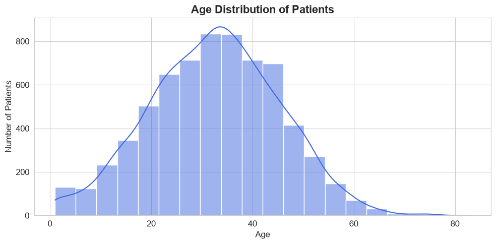
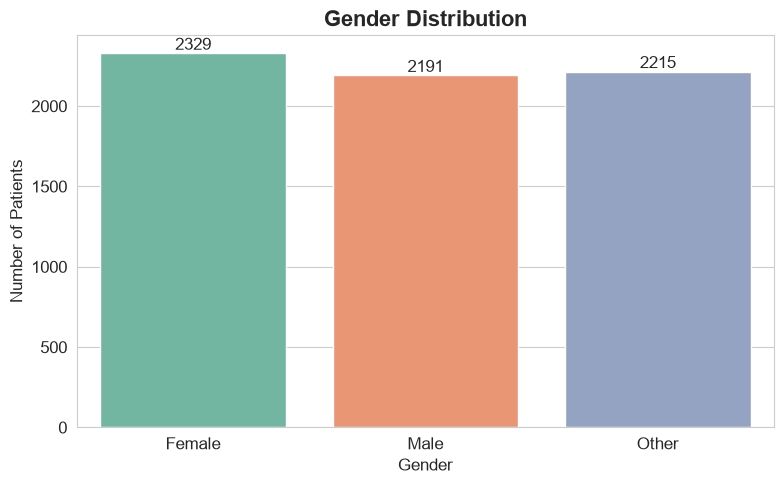
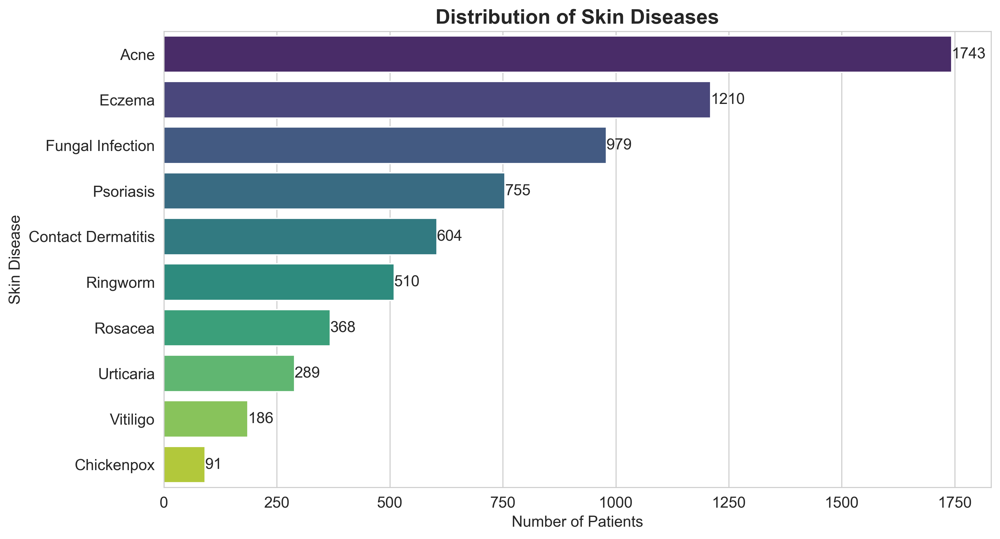
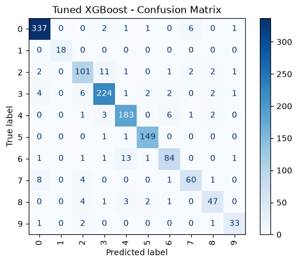

# AI Dermatology Assistant
### Skin Disease Prediction Using Machine Learning and Gemini AI

**Capstone Project 2 | Data Science & Machine Learning**  
**Author:** Mohammad Hummad Siddiqui  
**Institute:** Imarticus Learning

An academic machine-learning application that predicts one of 10 skin-disease classes from user-entered symptom and health information. The application uses a tuned XGBoost classifier for prediction and Google Gemini AI to generate a patient-friendly explanation.

> **Important medical disclaimer:** This is an academic prototype trained on a synthetic dataset. It is not a medical device, does not provide a medical diagnosis and must not be used to make treatment decisions. Predictions and AI-generated explanations may be inaccurate. Consult a qualified healthcare professional for medical advice.

---

## Table of Contents
- [Project Overview](#project-overview)
- [Project Objectives](#project-objectives)
- [Dataset](#dataset)
- [Exploratory Data Analysis](#exploratory-data-analysis)
- [Data Preparation](#data-preparation)
- [Model Development](#model-development)
- [Application Features](#application-features)
- [System Workflow](#system-workflow)
- [Project Structure](#project-structure)
- [Installation and Setup](#installation-and-setup)
- [Model Results](#model-results)
- [Limitations and Future Scope](#limitations-and-future-scope)
- [Acknowledgements](#acknowledgements)

## Project Overview

Skin conditions can have symptoms that are difficult for people to interpret. This project explores how machine learning and generative AI can be combined in an educational application to help users understand symptom-based predictions.

The project includes a data-science workflow—from data cleaning and exploratory analysis to model comparison, hyperparameter tuning and a Streamlit interface. Gemini AI is used to provide a natural-language explanation alongside the model output.

The classifier predicts one of the following 10 classes:

1. Acne
2. Eczema
3. Psoriasis
4. Ringworm
5. Rosacea
6. Vitiligo
7. Chickenpox
8. Urticaria
9. Contact Dermatitis
10. Fungal Infection

## Project Objectives

- Explore a structured symptom dataset and identify patterns in patient and symptom attributes.
- Prepare categorical and numerical features for machine-learning models.
- Compare multiple classification algorithms.
- Tune the best-performing model using `GridSearchCV`.
- Build a Streamlit application for entering patient and symptom information.
- Integrate Gemini AI to generate easy-to-understand explanations.
- Provide an option to generate and download a report from the application.

## Dataset

The project presentation describes a dataset of **6,735 patient records** and **10 disease classes**. The data is synthetic and was created for academic modelling; it is not a collection of verified clinical records.

The dataset contains demographic, symptom, skin, lifestyle and medical-history attributes. Examples documented in the project include:

- Demographics: age, gender and BMI
- Symptoms: itching level, rash type, fever, pain and pus/discharge
- Skin and body information: affected body area, skin type and severity-related attributes
- History and lifestyle: family history, allergy history, stress level, sleep hours and water intake

The repository includes the original, cleaned and preprocessed CSV files under `data/`.

## Exploratory Data Analysis

The EDA notebooks and saved visualisations explore:

- Disease-class distribution
- Age distribution
- Gender distribution
- Affected body-area distribution
- Rash-type distribution
- Correlations between numerical features

Selected observations reported in the capstone presentation:

- Acne is the most frequent class in the dataset, with 1,743 records.
- Chickenpox is the least frequent class, with 91 records.
- The majority of records fall in the 20–40 age range.
- Face is the most frequently reported affected body area.
- Pimples is the most common rash type.

These observations describe this synthetic dataset only; they should not be interpreted as real-world disease prevalence.

## Data Preparation

The data-cleaning and modelling notebooks document steps including:

- Removing duplicate records.
- Standardising category labels and correcting spelling inconsistencies.
- Handling missing values.
- Dropping the patient identifier from model features.
- Binary mapping for Yes/No fields.
- Ordinal mapping for ordered categories such as itching, humidity exposure and stress level.
- One-hot encoding for selected nominal fields.
- Label encoding for body area, rash type and the target disease.
- Scaling where required by the preprocessing workflow.

The saved preprocessing objects are stored in `models/` and are used by the application prediction pipeline.

## Model Development

Four classification algorithms were compared:

| Algorithm | Role in the project |
|---|---|
| Logistic Regression | Baseline linear classifier |
| Decision Tree | Tree-based classification baseline |
| Random Forest | Ensemble of decision trees |
| XGBoost | Gradient-boosted tree classifier |

XGBoost achieved the highest baseline accuracy in the project. `GridSearchCV` was then used to tune its hyperparameters.

The best parameters recorded in the training notebook were:

```python
{
    "learning_rate": 0.05,
    "max_depth": 4,
    "n_estimators": 200,
    "subsample": 0.8
}
```

The final tuned XGBoost model was saved as `models/dermatology_model.pkl`.

## Model Results

The final evaluation notebook reports:

| Model | Test accuracy |
|---|---:|
| XGBoost before tuning | 90.42% |
| XGBoost after GridSearchCV | **91.76%** |
| Random Forest after tuning | 89.68% |

The tuned XGBoost model was selected for the Streamlit application.

Evaluation in the notebook also includes a confusion matrix and a classification report with precision, recall, F1-score and support for the disease classes.

**How to interpret this result:** The 91.76% figure is the test accuracy reported by this project on its synthetic dataset and its particular train/test split. It does not establish clinical accuracy or performance on real patients. Class-wise metrics and validation on independent, representative clinical data would be needed before any real-world medical use could be considered.

## Application Features

The Streamlit application is designed to provide an end-to-end demonstration:

- Patient and symptom information form.
- Prediction across the 10 supported disease classes.
- Prediction confidence information and top predicted classes.
- Gemini AI-generated, patient-friendly explanation and guidance.
- Downloadable PDF report.
- Prediction history.

Gemini AI is used to explain the model output in natural language. It does not independently verify the prediction or replace a clinician.

## Application Screenshots

### 1. Streamlit Application

The application allows users to enter their information and symptoms to receive a machine-learning prediction.


### 2. Exploratory Data Analysis

Visualisations used to understand the dataset and identify patterns.







### 3. Model Evaluation

Confusion matrix and model performance comparison.




## System Workflow

```text
User enters symptom and health information
                 |
                 v
       Streamlit application
                 |
                 v
       Input preprocessing
     (encoding and scaling)
                 |
                 v
       Tuned XGBoost model
                 |
                 v
     Predicted disease class
       and model confidence
                 |
          +------+------+
          |             |
          v             v
     Display result   Gemini AI API
                         |
                         v
               Natural-language explanation
          |
          v
     Report generation / download
```

## Project Structure

```text
AI_Dermatology_Assistant/
├── data/
│   ├── dermatology_capstone_dataset.csv
│   ├── dermatology_cleaned_dataset.csv
│   └── dermatology_preprocessed_dataset.csv
├── images/
│   ├── EDA visualisations
│   ├── model evaluation charts
│   └── Streamlit application screenshots
├── models/
│   ├── dermatology_model.pkl
│   ├── disease_encoder.pkl
│   ├── feature_names.pkl
│   ├── label_encoders.pkl
│   └── scaler.pkl
├── notebook/
│   ├── 01_Data_Cleaning.ipynb
│   ├── 02_EDA.ipynb
│   ├── 03_Multi_Class_Model_Training.ipynb
│   └── 04_Model_Training_and_Evaluation.ipynb
├── reports/
│   └── AI_Dermatology_Assistant_Capstone_Presentation.pptx
├── streamlit_app/
│   ├── .env.example
│   ├── app.py
│   ├── llm_helper.py
│   └── prediction.py
├── requirements.txt
└── README.md
```

## Installation and Setup

### 1. Clone the repository

```bash
git clone https://github.com/hummad01/ai-dermatology-assistant.git
cd ai-dermatology-assistant
```

### 2. Create and activate a virtual environment

**Windows PowerShell:**

```powershell
python -m venv .venv
.venv\Scripts\Activate.ps1
```

**Windows Command Prompt:**

```bat
python -m venv .venv
.venv\Scripts\activate
```

### 3. Install dependencies

```bash
pip install -r requirements.txt
```

### 4. Configure the Gemini API key

Create a file named `.env` inside the `streamlit_app/` directory. Add your own Gemini API key:

```env
GEMINI_API_KEY=YOUR_GEMINI_API_KEY_HERE
```

The `.env` file must remain private and must never be committed to GitHub. The repository includes `.env.example` as a template.

### 5. Run the Streamlit application

From the repository root, run:

```bash
streamlit run streamlit_app/app.py
```

The application should open in your browser.

## Limitations and Future Scope

### Current limitations

- The model is trained on synthetic data, not real clinical records.
- Predictions are based on user-entered structured information; the application does not analyse skin images.
- Performance depends on the quality and representativeness of the input data.
- The reported test accuracy does not demonstrate clinical validity or generalisation to real patients.
- Gemini-generated explanations can be incomplete or incorrect and require professional verification.

### Future scope

- Evaluate the approach on appropriately governed, representative clinical datasets.
- Conduct independent validation and more detailed class-wise error analysis.
- Explore image-based analysis only with suitable data, expert oversight and rigorous validation.
- Improve accessibility through multilingual support and deployment improvements.
- Add clinician-reviewed educational content and clearer safety guidance.

## Acknowledgements

This project was completed as **Capstone Project 2** in the Data Science & Machine Learning programme at **Imarticus Learning**.

---

**Author:** Mohammad Hummad Siddiqui  
**GitHub:** [hummad01](https://github.com/hummad01)  
**LinkedIn:** [Mohammad Hummad Siddiqui](https://www.linkedin.com/in/mohammad-hummad-siddiqui-656b73306/)
